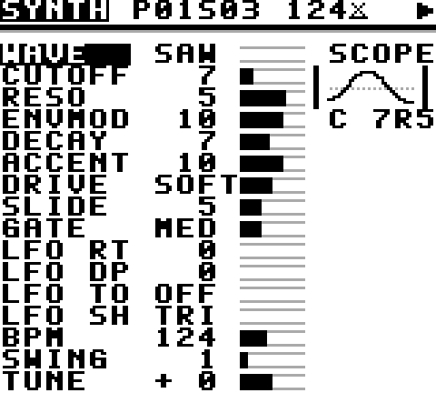
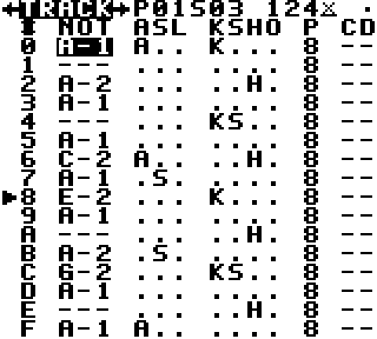
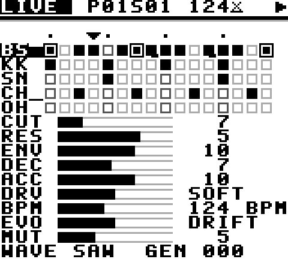

# ETCH — A Generative Acid Machine

**by Synth Centric**

ETCH is an acid bass synthesizer, four-lane drum machine, 16-step sequencer and generative composer (**CORROSION**) for the original Nintendo Game Boy. It is also a Synth Centric music release: eight playable, mutable tracks in one ROM.

Switch on, press START, and acid plays. From there you can perform it, reshape it, let it rewrite itself, and save your version.

  

```
 SYNTH  ◄  TRACK  ◄  LIVE  ►  GEN  ►  SONG  ►  FILE      (SELECT + LEFT/RIGHT)
```

LIVE is home: watch, play and program the pattern, sweep the sound, fire fills, and **REGEN** (tap A on the RGN row to replace exactly half the bar with something new). SELECT+LEFT opens the tracker-style step editor; SELECT+LEFT again opens the per-channel sound engine. SELECT+RIGHT takes you back, and further right are the composer (GEN), arrangement and tempo (SONG), and FILE (new, load the demo songs or your saves, save, and about).

**Living songs:** with EVO on DRIFT (the demo songs start this way), every 4 bars every channel changes a little, using randomness from your button timing, so in practice every listen is different. The manual (§12, *Will every listen be unique?*) explains how and the limits.

Editing works the same everywhere: **A** places or toggles, **A + D-pad** changes values, **B + A** deletes.

| | |
|---|---|
| ROM | `release/ETCH_by_Synth_Centric.gb` (128 KB, MBC5+RAM+BATTERY, 32 KB SRAM, DMG; runs on CGB/GBA in DMG mode) |
| Source | `release/ETCH_Source.zip` |
| Demo | `release/ETCH_Demo.wav`: 2 minutes recorded from the ROM in SameBoy |
| Manual | [`docs/ETCH_Manual.md`](docs/ETCH_Manual.md) and `release/ETCH_Manual.pdf` (`make pdf`) |
| Controls | [`docs/CONTROLS.md`](docs/CONTROLS.md) |
| Sound engine | [`docs/SOUND_ENGINE.md`](docs/SOUND_ENGINE.md) |
| CORROSION | [`docs/GENERATIVE_SYSTEM.md`](docs/GENERATIVE_SYSTEM.md) |
| Hardware | [`docs/HARDWARE_COMPATIBILITY.md`](docs/HARDWARE_COMPATIBILITY.md) |
| Test report | [`docs/TESTING.md`](docs/TESTING.md) |
| Release notes | [`docs/RELEASE_NOTES.md`](docs/RELEASE_NOTES.md) |

## Playing it

Open `ETCH_by_Synth_Centric.gb` in any Game Boy emulator (SameBoy, BGB, Gambatte, mGBA, Emulicious and others), or copy it to a flash cartridge with SRAM saving enabled. Use headphones: the bass is below what the speaker can reproduce.

## Building

### Requirements

- **GBDK-2020 4.3.0**: <https://github.com/gbdk-2020/gbdk-2020/releases/tag/4.3.0> (`gbdk-linux64.tar.gz`, or the macOS/Windows package)
- **Python 3.8+** with **NumPy** (wavetable generation and tests)
- GNU **make** and a host C compiler (`cc`, for the generator unit tests)

### Build

```bash
tar xzf gbdk-linux64.tar.gz -C /opt
```

```bash
make GBDK_HOME=/opt/gbdk
```

The ROM is written to `build/ETCH_by_Synth_Centric.gb`, and its header is validated automatically by `tools/check_rom.py`. All generated data (wavetables, transfer LUTs, engine tables, font and logo tiles, ROM tracks) is produced by the scripts in `tools/` and is also committed, so the build is reproducible. A clean build takes about 30 seconds.

### Tests

```bash
make hosttest
```

```bash
tests/sameboy/build.sh /path/to/SameBoy
```

```bash
make emutest
```

- `make hosttest` runs the CORROSION unit tests on the host (32 checks).
- `tests/sameboy/build.sh` builds the optional emulator harness. Point it at a SameBoy checkout that has run `make lib bootroms`; RGBDS is needed for the boot ROMs.
- `make emutest` runs the 100 integration checks in SameBoy: boot, screens, timing, audio, CORROSION, locks, undo, saves and tracks.

`tests/profile.py` gives a per-function CPU profile of the ROM. `tools/record_demo.py` re-records the demo WAV.

### Release

```bash
make release
```

This copies the ROM to `release/` and builds `release/ETCH_Source.zip`.

## Repository layout

```
include/            shared headers (data model, engine, UI, CORROSION, storage)
src/main.c          boot, main loop, global controls, evolution scheduling
src/audio/          bass voice (engine.c), wave-RAM loader + 8x8 multiply (wave_load.s), lookup tables
src/sequencer/      256 Hz timer ISR, step logic, swing clock, chains, fills, commit/undo
src/drums/          drum synthesis and channel priority
src/generator/      CORROSION (portable C): generation, mutation, fills, seed codes
src/ui/             screens, UI core, safe VRAM writes, generated graphics
src/storage/        SRAM slots, Fletcher-16 checksum (asm)
src/presets/        generated ROM tracks
assets/generated_waves/  generated wavetables + transfer LUTs (C and .bin)
tools/              generators, ROM checker, demo recorder, source packager
tests/              host unit tests, emulator tests, SameBoy harness, profiler
docs/               manual and technical documentation
release/            ROM, source archive, demo
```

## Credits

**ETCH — A Generative Acid Machine — by Synth Centric.** Synth Centric is Dan Schwebel, an Australian beat maker, music producer, writer and educator. Built with GBDK-2020/SDCC. Tested with SameBoy and PyBoy.

Thanks to furrtek's GB-303 (CC BY 4.0), whose source was studied as a technical reference. No GB-303 code or data is included; see [`THIRD_PARTY_NOTICES.md`](THIRD_PARTY_NOTICES.md).

Code: MIT. Music, name and artwork © Synth Centric. See [`LICENSE`](LICENSE).
