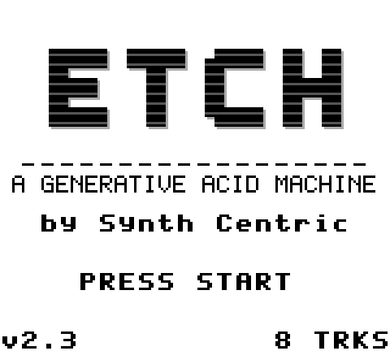
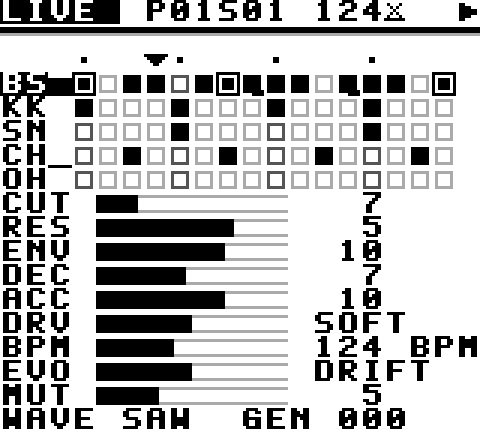
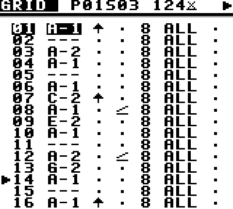
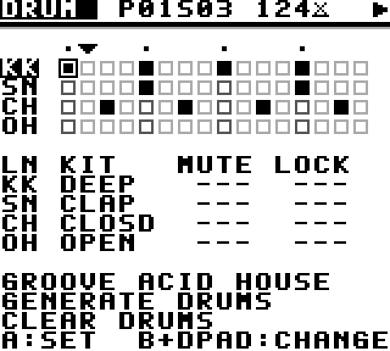
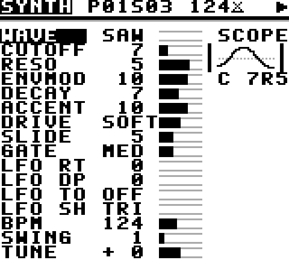
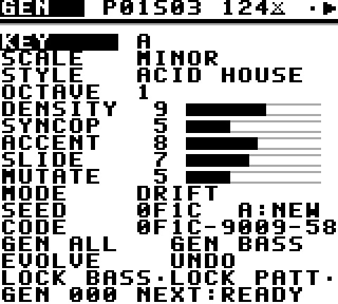
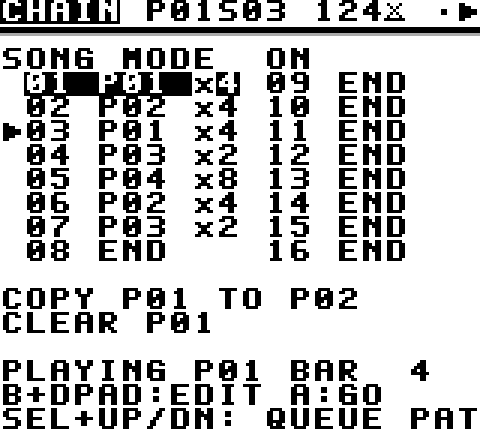

# ETCH — A Generative Acid Machine
### by Synth Centric

**User Manual — version 1.0**



---

## 1. Introduction

ETCH turns a Game Boy into an acid bass synthesizer, a four-lane drum machine, a 16-step sequencer and a generative composer.

It is also a **Synth Centric music release**. The cartridge holds eight tracks. Each one is a starting point that you can play as written, reshape, mutate and save as your own version. The instrument itself is the artwork, so every copy will end up sounding different.

> *A machine that makes acid music. A machine that slowly rewrites itself.*

ETCH draws on the Roland TB-303 and on furrtek's GB-303 project, but its sound engine, sequencer, generative system and interface are original.

---

## 2. Hardware compatibility

- Original Game Boy (DMG), Game Boy Pocket and Light, Game Boy Color (in DMG mode), and Game Boy Advance / SP (in DMG mode).
- Any accurate emulator (SameBoy, BGB, Gambatte, mGBA, Emulicious and others).
- Cartridge type: MBC5 with 32 KB battery-backed RAM, 128 KB ROM.
- **Use headphones or line out.** The Game Boy speaker cannot reproduce bass.

ETCH has so far been verified in emulators only. See `HARDWARE_COMPATIBILITY.md` for details and flash-cartridge saving notes.

---

## 3. Installation and ROM use

- **Emulator:** open `ETCH_by_Synth_Centric.gb`. Saves go to the emulator's battery file (usually `ETCH_by_Synth_Centric.sav` next to the ROM).
- **Flash cartridge:** copy the `.gb` file to the SD card and make sure SRAM saving is enabled for it.
- **Building from source:** see `README.md`.

---

## 4. Quick start

1. Switch on. The ETCH title appears.
2. Press **START**. Track 1, *FIRST CONTACT*, starts immediately, and you are on the **LIVE** screen.
3. Press **DOWN** five times to highlight **CUT**, then hold **RIGHT**. The filter opens and the bass starts to scream. Hold **LEFT** to close it again.
4. Move to **RES** and push it up for more squelch.
5. Press **A** for a drum fill.
6. Press **SELECT + A**. At the next bar line, CORROSION rewrites a little of the bass line. Did you not like it? Press **SELECT + B** to undo.
7. Press **START** to stop.

The basic gestures: **SELECT + LEFT/RIGHT** changes screen, **hold B + D-pad** changes values, and **START** is play/stop. The complete list is in `CONTROLS.md`.

---

## 5. Controls

Every screen has a header line:

```
LIVE  P01S03 124xU ▶
```

| Element | Meaning |
|---|---|
| `LIVE` | Screen name |
| `P01` | The pattern now playing |
| `>P02` | The pattern queued for the next bar (shown instead of the S field) |
| `S03` | The song (chain) position, when song mode is on |
| `124` | BPM |
| Fill mark (dotted bar, left of the BPM) | Shown while a fill is active |
| `x` over a bar | Evolution (DRIFT or CORRODE) is on |
| `U` | An undo is available |
| ▶ / ■ | Playing / stopped |

The second line shows a status message when something happens: SAVED, EVOLVED, UNDO and so on.

### Global controls

| | |
|---|---|
| START | Play / stop |
| SELECT + LEFT / RIGHT | Change screen: LIVE · GRID · DRUM · SYNTH · GEN · CHAIN · SAVE |
| SELECT + UP / DOWN | Queue the next / previous pattern (switches at the bar line) |
| SELECT + A | Evolve now |
| SELECT + B | Undo |

---

## 6. Live performance — the LIVE screen



The top half is an overview of the current pattern:

- The ▼ playhead marks the current step.
- The **BS** row is the bass line. A filled cell is a note, a framed cell is an accent, a cell with a tail is a slide, and a bar is a tie.
- **KK SN CH OH** are the drum lanes.
- The column next to each lane name flashes when the lane plays, or shows ✕ when the lane is muted.

The lower half holds nine **macros**, each with a meter:

| Macro | What it does to the sound |
|---|---|
| **CUT** | Filter cutoff. Low is dark and muffled; high is bright and buzzing. The most important acid control. |
| **RES** | Resonance. Adds the squelchy, vocal peak. High settings whistle as the filter moves. |
| **ENV** | How far each note's envelope opens the filter. High ENV gives the "wow" on every note. |
| **DEC** | How long that envelope takes to close. Low values are plucky and percussive; high values give long, evolving sweeps. |
| **ACC** | Accent strength: how much louder and sharper accented notes are. |
| **DRV** | Drive: OFF, SOFT (warm saturation) or HARD (digital clipping). |
| **BPM** | Tempo, 60–220. |
| **EVO** | Evolution mode: STABLE, DRIFT or CORRODE. |
| **MUT** | Mutation intensity: how much CORROSION changes at a time. |

**UP/DOWN** selects a row. **LEFT/RIGHT** adjusts it; hold the button to sweep, and hold **B** as well for big jumps. On a lane row, LEFT/RIGHT mutes or unmutes that lane. **A** plays a **FILL**: a drum fill that lasts until the end of the bar, then returns to the groove by itself.

Cutoff, resonance and the other sound controls act **immediately**. Pattern changes wait for the next bar line, and evolutions for the end of a phrase, so you can't knock the music out of time.

---

## 7. Programming basslines — the GRID screen



Each of the 16 rows is one 16th-note step:

```
> 01 A-1 ↑ . 8 ALL .
     note A S P cond L
```

| Column | Meaning |
|---|---|
| NOTE | `C#2` is a note. `---` is a **rest**. `===` is a **tie**: the previous note keeps sounding without retriggering. |
| A | **Accent**: louder, with a sharper filter snap. |
| S | **Slide**: the note is held and *glides* into the next note, without a new attack. This is the acid "bend". |
| P | **Probability** 1–8. 8 always plays; 4 plays half the time. It is rolled again every time the step comes round. |
| CND | **Condition**. `1:2` plays only on the first of every two passes; `3:4` only on the third of every four; `FIL` only during fills; `!FL` never during fills. |
| L | **Lock**. CORROSION never changes this step. |

Editing:

- Move with the D-pad.
- On NOTE, **A** cycles REST → NOTE → TIE.
- **Hold B + UP/DOWN** changes the note by a semitone; **B + LEFT/RIGHT** changes it by an octave. When stopped, you hear each note as you set it.
- On A, S and L, **A** toggles.
- On P and CND, **hold B + UP/DOWN** changes the value.

Notes vs rests vs ties:

- A **rest** ends the previous note at its gate point.
- A **tie** keeps it sounding.
- A **slide** keeps it sounding *and* bends the pitch into the next note.

> **Workflow: a classic acid line from scratch**
> 1. GEN screen: set PATT lock off. On GRID, set all 16 steps to rest, or use CHAIN → CLEAR.
> 2. Put the root note (say A1) on steps 1, 4, 7, 9, 12 and 15. Put the octave (A2) on 3 and 11. Put a minor third (C2) on 6 and a fifth (E2) on 14.
> 3. Accent steps 4, 9 and 15. Add slides on 6 and 11.
> 4. On LIVE: CUT about 8, RES 5–6, ENV 10, DEC 6. Press START.
> 5. Ride CUT and DEC while it plays. Slides with accents are the classic acid gesture.

---

## 8. Programming drums — the DRUM screen



The grid shows 4 lanes × 16 steps. Move the cursor and press **A** to add or remove a hit.

Below the grid, each lane has three settings:

- **KIT**: hold B + UP/DOWN to choose the sound. You hear it immediately.
- **MUTE**
- **LOCK**: CORROSION will not touch the lane.

| Lane | Sounds |
|---|---|
| KK (kick) | DEEP, PUNCH, THUD, CLICK |
| SN (snare) | SHORT, GRIT, CLAP, RIM |
| CH (closed hat) | CLOSED, TICK (metallic), SHAKE, SHARP |
| OH (open hat / perc) | OPEN, METAL, BLIP (tonal), CRASH |

The bottom three rows:

- **GROOVE**: choose ACID HOUSE, ELECTRO, MINIMAL, BROKEN, INDUSTRIAL or SPARSE, then press A to load that style's groove into all unlocked lanes. Each groove is a different rhythm, not just random hits:
  - ACID HOUSE: four-on-the-floor kick, clap backbeat, off-beat hats.
  - ELECTRO: syncopated 808-style kick.
  - MINIMAL: kick with sparse rim and off-beat ticks.
  - BROKEN: a displaced kick.
  - INDUSTRIAL: relentless 16ths.
  - SPARSE: half-time.
- **GENERATE DRUMS**: a new groove from the GEN settings.
- **CLEAR DRUMS**: clears all unlocked lanes.

All three can be undone with SELECT + B.

The Game Boy has only three channels for drums, so the snare, closed hat and open hat share the noise channel. When they land on the same step, the snare wins over the open hat, which wins over the closed hat.

---

## 9. Understanding the synthesizer — the SYNTH screen



The **SCOPE** in the corner shows the actual waveform the Game Boy is playing at this moment. Watch it change as the filter moves.

| Parameter | Sound |
|---|---|
| **WAVE** | SAW is the classic, raw acid tone. SQR is hollower and more nasal. HOLW is round and soft, so the resonance sings over it. BITE is a synced, metallic digital tone. |
| **CUTOFF** | Brightness (0–31). |
| **RESO** | Resonance (0–7): the squelch. |
| **ENVMOD** | Envelope depth: how far each note opens the filter. |
| **DECAY** | Envelope length: short and plucky up to long and sweeping. Also slows the volume decay. |
| **ACCENT** | Accent strength. Consecutive accents build up and get brighter, as on old acid hardware. |
| **DRIVE** | OFF / SOFT / HARD distortion. |
| **SLIDE** | Glide time, from instant to a slow, lazy bend. |
| **GATE** | Note length: SHRT, MED, LONG, FULL. |
| **LFO RT / DP / TO / SH** | A low-frequency oscillator. RT is rate (0.1–22 Hz) and DP is depth. TO is the target: PTCH (vibrato), CUT (auto-wah), RES (resonance wobble). SH is the shape: TRI, SQR, SAW or S&H (random steps). |
| **BPM / SWING** | Tempo and shuffle (0–8). Swing delays every second 16th; the tempo stays exact. |
| **TUNE** | Transposes the whole bass line ±12 semitones. |

Press **A** when stopped to audition a note.

How it works (in brief): the Game Boy has no filter. ETCH holds 1 024 pre-calculated waveforms, one for each oscillator, resonance and cutoff combination, rendered from a model of a resonant 4-pole filter. It switches between them many times a second as the envelopes move. See `SOUND_ENGINE.md`.

---

## 10. Using CORROSION — the GEN screen



CORROSION is ETCH's composer. It doesn't throw random notes around. It works with a **key and scale**, a small **pitch vocabulary**, a **motif** that repeats, **accent and slide habits**, and a **relationship with the kick drum**, all shaped by a **style**.

| Setting | Use |
|---|---|
| KEY, SCALE, OCTAVE | Which notes are allowed and where they sit. MINOR, DORIAN and PHRYGIAN are dark; MIN PENT is safe; CHROMATIC is anything goes. |
| STYLE | The rhythmic personality (see §8). |
| DENSITY | How busy. |
| SYNCOP | How much the line avoids the beat. |
| ACCENT, SLIDE | How often. |
| MUTATE, MODE | Evolution (§12). |
| SEED | Which version you get. |

The action rows:

- **GEN ALL** writes a complete new bass line and drum groove.
- **GEN BASS** writes only the bass line.
- **A on the SEED row** picks a new random seed and generates in one press. Keep pressing it to audition ideas.

> **Workflow: generate a complete groove**
> 1. GEN: KEY A, SCALE MINOR, STYLE ACID HOUSE, DENSITY 9, ACCENT 8, SLIDE 7.
> 2. Highlight SEED and press **A** until you hear something you like.
> 3. Go to LIVE and shape it with CUT, RES and ENV.
> 4. Note the **CODE** so you can find it again.

---

## 11. Musical generation and random seeds

The **CODE** row shows a 12-digit code such as `0F1C-9009-5870`. It packs the seed, key, scale, style, density, syncopation, accent, slide and octave.

To recreate a groove, select the CODE row, step through the digits with LEFT/RIGHT, set each with **B + UP/DOWN**, then press **GEN ALL** on an unlocked pattern. You get exactly the same initial groove, every time, on every Game Boy.

**What a code does not store:** manual edits, kit changes, sound settings, locks and evolution history. Use the SAVE screen to keep those.

---

## 12. Locks, evolution and undo

### Evolution modes (EVO on LIVE, MODE on GEN)

| Mode | Behaviour |
|---|---|
| **STABLE** | The pattern stays exactly as written. Probability and conditions still add variation as it plays. |
| **DRIFT** | Every 4 bars, a few small changes: an accent moves, a note steps within the scale, a hat is added. DRIFT **remembers your groove**. It never strays more than a few events from it and keeps drifting back. This is the right mode for long hypnotic sets. |
| **CORRODE** | Every 2 bars, bigger changes. The motif itself mutates, and its repetitions change with it, so over a few minutes the line becomes something new that is clearly descended from where it started. |

**MUT** (0–15) sets how many changes happen each time.

Even in STABLE, **SELECT + A** evolves once, on demand, at the next bar line.

### Locks

| Lock | Where | Protects |
|---|---|---|
| Step lock | GRID, L column | One bass step |
| Lane lock | DRUM screen | One drum lane |
| LOCK BASS | GEN | The whole bass line |
| LOCK PATT | GEN | The entire pattern from evolution and generation |

Locked material is *guaranteed* unchanged. It is restored bit-for-bit after every mutation.

### Undo

**SELECT + B** restores the pattern as it was before the last evolution, GENERATE, groove load or clear. Undo is one step deep.

> **Workflow: lock a motif and mutate around it**
> 1. On GRID, lock (L) the steps of the hook, for example steps 1–4.
> 2. On DRUM, lock the KK lane so the kick stays four-on-the-floor.
> 3. Set EVO to CORRODE, MUT 10. Everything except your hook and kick now transforms around them.
> 4. If a mutation goes somewhere you don't like, press SELECT + B.

---

## 13. Saving and loading — the SAVE screen


There are eight **slots** (S1–S8) and the eight **ROM tracks** (T1–T8).

- **Saving a project** stores everything: all 32 patterns, the chain, sound settings, GEN settings and mutes.
- **Slot actions:** LEFT/RIGHT chooses LOAD, SAVE or ERAS(e); press **A** to arm and **A** again to confirm. Saving to an empty slot happens immediately.
- Every save is checked: ETCH writes, then re-reads and checksums the data before reporting `SAVED + VERIFIED`.
- The `*` marks the slot you saved last.
- A damaged slot shows `!CORRUPT!` and cannot be loaded, so your current work stays safe. Empty or never-used memory shows `--empty--`.
- **A, A on a track** reloads that ROM track. This replaces the working project, so save first.

> **Workflow: save a project for later**
> SELECT+LEFT from LIVE goes straight to SAVE. Choose a slot, set SAVE, press A (and A again to overwrite). Wait for `SAVED + VERIFIED`. On a flash cart, make sure the cart writes its save file. See `HARDWARE_COMPATIBILITY.md`.

---

## 14. Pattern chaining and song mode — the CHAIN screen



ETCH has **32 patterns**. Each has its own bass line, drums, kits and locks; all patterns share the same synth settings. The **chain** has 16 slots, each holding a pattern and a bar count (1–8).

- **SONG MODE ON:** playback follows the chain and loops back to slot 1 after the last slot, or at an `END` marker.
- **SONG MODE OFF (loop mode):** the current pattern loops. Change patterns with SELECT + UP/DOWN or by pressing A on a chain slot. Changes always happen at the next bar line.

Editing:

- Select a slot.
- **B + UP/DOWN** sets the pattern (or END); **B + LEFT/RIGHT** sets the bars.
- **A** jumps there at the next bar.

**COPY** duplicates the current pattern to another number. This is the quickest way to make variations: copy, then edit or GEN BASS the copy. **CLEAR** (A twice) empties the current pattern.

An arrangement such as INTRO → GROOVE A → GROOVE B → BREAK → GROOVE C → OUTRO is simply six chain slots pointing to six patterns.

---

## 15. Musical performance tips

- **Ride the decay.** Short DEC with high ENV gives tight, plucky acid. Opening DEC while the resonance is high makes the classic long squelch.
- **Accents plus slides** carry most of the character in acid. Put them on off-beats.
- **Let DRIFT play for minutes.** It keeps the groove recognisable while it breathes.
- **Use CORRODE as a build.** Run it for 16 bars, then switch to STABLE when you find a line you like, and SAVE it.
- **Mute the bass (BS row on LIVE) for breakdowns,** then bring it back on a fill.
- **Probability on hats and ghost notes** (P 5–6) makes even a STABLE pattern feel alive.

> **Workflow: a four-minute evolving acid piece**
> 1. Load T1 *FIRST CONTACT* (or press START at power-on). It runs in song mode with DRIFT.
> 2. 0:00–1:00: let the chain play. Slowly raise CUT from 7 to about 14.
> 3. 1:00: set EVO to CORRODE, MUT 8. Add RES up to 7. Fill (A) every 8 bars.
> 4. 2:00: mute KK and SN on LIVE for 8 bars, then sweep DEC up. Unmute on a fill.
> 5. 2:30: if the line has wandered somewhere great, set EVO to STABLE to freeze it. SELECT+B takes back the last change.
> 6. 3:30: set EVO to DRIFT, pull CUT down to 3, mute the bass, stop on the downbeat.
> 7. Save the result to a slot.

---

## 16. Troubleshooting

| Problem | Solution |
|---|---|
| I hear almost no bass | Use headphones or line out. The speaker can't reproduce bass. Also check that CUT isn't at 0 and the BS lane isn't muted (✕ on LIVE). |
| A button press did nothing | Values change only with **B held** (except LEFT/RIGHT on LIVE, SYNTH and GEN). SELECT combinations need SELECT held *first*. |
| The pattern keeps changing by itself | EVO/MODE is DRIFT or CORRODE. Set STABLE, or lock what you want to keep. |
| A pattern change doesn't happen | Changes wait for the next bar line. If SONG MODE is on, the chain decides; SELECT+UP/DOWN turns song mode off. |
| Evolve does nothing | The pattern is LOCK PATT locked, or everything is locked. |
| Saves are lost after power-off | Your cartridge isn't saving SRAM (check the battery and flash-cart settings), or your emulator isn't keeping `.sav` files. |
| A slot shows `!CORRUPT!` | Its data failed the checksum. It is ignored for safety. ERASE it and save again. |
| Clicks or grit during filter sweeps | This is by design: the waveform is swapped while it plays (see `SOUND_ENGINE.md`). It is part of ETCH's sound. |

---

## 17. Technical specifications

| | |
|---|---|
| Voices | Acid bass (CH3 wavetable) + kick (CH1) + tone percussion (CH2) + noise percussion (CH4) |
| Bass oscillators | SAW, SQUARE, HOLLOW, BITE |
| Filter model | 32 cutoff × 8 resonance pre-rendered 4-pole ladder responses per oscillator |
| Drive | OFF / SOFT / HARD |
| Modulation | Filter envelope, accent envelope with charge, VCA envelope, LFO (4 shapes, 3 targets) |
| Sequencer | 16 steps; note / rest / tie, accent, slide, probability, 9 conditions, step lock |
| Drums | 4 lanes × 16 steps, 16 sounds, per-lane lock and mute |
| Patterns / chain | 32 patterns, 16-slot chain (1–8 bars each), song and loop modes |
| Tempo | 60–220 BPM, swing 0–8; 256 Hz engine clock; long-term tempo error < 0.01 % |
| Generation | 6 styles, 6 scales, seeded and reproducible (12-digit codes) |
| Evolution | STABLE / DRIFT / CORRODE, 11 mutation operators, one-level undo |
| Storage | 8 project slots in 32 KB battery SRAM, versioned and checksummed |
| ROM | 128 KB MBC5 (+RAM+BATTERY) |

---

## 18. Credits and acknowledgements

**ETCH — A Generative Acid Machine**
by Synth Centric

- Concept, music and release: **Synth Centric**.
- Instrument design and software: developed for Synth Centric.
- Built with **GBDK-2020** and **SDCC** (see `THIRD_PARTY_NOTICES.md`).
- Tested with **SameBoy** by Lior Halphon, and **PyBoy**.
- Thanks to **furrtek** for **GB-303** (CC BY 4.0). Its source was studied to understand acid synthesis on Game Boy hardware. No GB-303 code or data is included in ETCH.
- The TB-303 is a trademark of Roland Corporation. ETCH is not affiliated with Roland.

*The eight tracks:*

1. FIRST CONTACT
2. CONCRETE
3. STATIC
4. CORROSION
5. NIGHT SHIFT
6. WAREHOUSE
7. SIGNAL LOSS
8. AFTERIMAGE

All tracks © Synth Centric.
