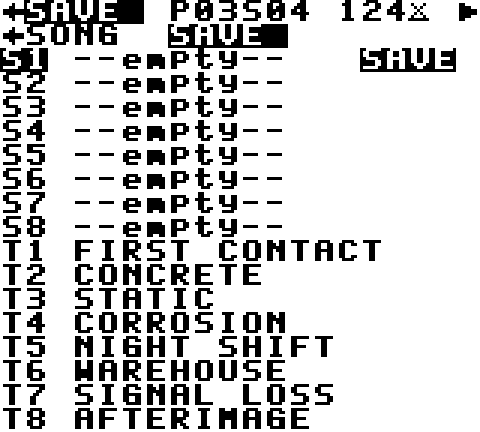

# ETCH — A Generative Acid Machine
### by Synth Centric

**User Manual — version 1.1**


---

## 1. Introduction

ETCH turns a Game Boy into an acid bass synthesizer, a four-lane drum machine, a 16-step sequencer and a generative composer.

It is also a **Synth Centric music release**. The cartridge holds eight tracks. Each one is a starting point that you can play as written, reshape, mutate and save as your own version. The instrument itself is the artwork, so every copy will end up sounding different.

> *A machine that makes acid music. A machine that slowly rewrites itself.*

ETCH draws on the Roland TB-303 and on furrtek's GB-303 project, but its sound engine, sequencer, generative system and interface are original.

---

## 2. Hardware compatibility

- Original Game Boy (DMG), Game Boy Pocket and Light, Game Boy Color (in DMG mode), and Game Boy Advance / SP (in DMG mode).
- Any accurate emulator (SameBoy, BGB, Gambatte, mGBA, Emulicious and others).
- Cartridge type: MBC5 with 32 KB battery-backed RAM, 128 KB ROM.
- **Use headphones or line out.** The Game Boy speaker cannot reproduce bass.

ETCH has so far been verified in emulators only. See `HARDWARE_COMPATIBILITY.md` for details and flash-cartridge saving notes.

---

## 3. Installation and ROM use

- **Emulator:** open `ETCH_by_Synth_Centric.gb`. Saves go to the emulator's battery file (usually `ETCH_by_Synth_Centric.sav` next to the ROM).
- **Flash cartridge:** copy the `.gb` file to the SD card and make sure SRAM saving is enabled for it.
- **Building from source:** see `README.md`.

---

## 4. Quick start

1. Switch on. The ETCH title appears.
2. Press **START**. Track 1, *FIRST CONTACT*, starts immediately, and you are on **LIVE**, the home screen.
3. Press **DOWN** five times to reach **CUT**, then hold **RIGHT**. The filter opens and the bass starts to scream. Hold **LEFT** to close it again.
4. Move up into the lanes. On the **KK** row, move to an empty step and press **A**: you have added a kick. Press **A** again to take it away.
5. On the **BS** row, press **A** on an empty step to add a bass note. Hold **A** and press **RIGHT** to raise it a semitone, or **UP** for an octave.
6. Press **SELECT + A**. At the next bar line, CORROSION rewrites a little of the line. Press **SELECT + B** to undo it.
7. Press **SELECT + LEFT** to open the step editor, and **SELECT + LEFT** again for the sound engine. **SELECT + RIGHT** brings you back.
8. Press **START** to stop.

---

## 5. Controls

### The screen row

```
 SYNTH  ◄  TRACK  ◄  LIVE  ►  GEN  ►  SONG  ►  SAVE
```

**LIVE** is home. **SELECT + LEFT/RIGHT** moves along the row and stops at either end. Moving left takes you deeper into the music: first the step editor (TRACK), then the sound of each channel (SYNTH). Moving right takes you to the tools: the composer (GEN), the arrangement and tempo (SONG), and storage (SAVE). Each move briefly shows the neighbouring screens on line 2.

### One way of editing everywhere

ETCH's editing borrows the habits of trackers:

| | |
|---|---|
| **D-pad** | Move the cursor |
| **A** | Put something there or switch it. On an empty step, A writes a note or hit; on a filled one, A changes it. |
| **Hold A + LEFT/RIGHT** | Change a value by 1 (a semitone for notes) |
| **Hold A + UP/DOWN** | Change a value by a big step (an octave for notes) |
| **B + A** | Delete, or reset to default |
| **B + D-pad** | Jump: a beat in TRACK, a channel in SYNTH |

On the macro and parameter lists, plain LEFT/RIGHT also changes the value, so you can sweep a sound with one thumb.

### The header

```
◄LIVE ►P01S03 124xU ▶
```

| Element | Meaning |
|---|---|
| ◄ ► | Screens exist to the left / right |
| `P01` | The pattern now playing |
| `>02` | The pattern queued for the next bar (shown instead of the S field) |
| `S03` | Song position, when song mode is on |
| Fill mark (left of the BPM) | A fill is playing |
| `124` | BPM |
| `x` over a bar | Evolution (DRIFT or CORRODE) is on |
| `U` | An undo is available |
| ▶ / ■ | Playing (blinks on the beat) / stopped |

Line 2 shows messages such as SAVED, EVOLVED and UNDO, the screen map, and column hints.

### Global controls

| | |
|---|---|
| START | Play / stop |
| SELECT + LEFT / RIGHT | Move along the screen row |
| SELECT + UP / DOWN | Queue the next / previous pattern (switches at the bar line) |
| SELECT + A | Evolve now |
| SELECT + B | Undo |

The complete list is in `CONTROLS.md`.

---

## 6. LIVE — home, step entry and performance


The top half is the whole pattern at a glance, and you can edit it directly:

- The **BS** row is the bass line. A filled cell is a note, a framed cell an accent, a cell with a tail a slide, and a bar a tie.
- **KK SN CH OH** are kick, snare, closed hat and open hat/percussion.
- The ▼ playhead walks along the top. The ◄ on the right marks the row you're on.
- The small column after each lane name flashes when the lane plays, and shows ✕ when it is muted.

**Step entry on LIVE:**

| Where | What to press |
|---|---|
| Drum step | **A** puts a hit there or takes it away |
| Bass step | **A** on an empty step adds a note: the last note you used. **Tap A** on a note to remove it. **Hold A + LEFT/RIGHT** moves it a semitone; **A + UP/DOWN** an octave. When stopped, you hear each note as you set it. |
| Lane name (left of step 1) | **A** mutes or unmutes the lane |
| Any step | **B + A** clears it |

Accents, slides, ties, probability and conditions are set in TRACK.

The lower half holds nine **macros**, each with a meter:

| Macro | What it does to the sound |
|---|---|
| **CUT** | Filter cutoff. Low is dark and muffled; high is bright and buzzing. The most important acid control. |
| **RES** | Resonance: the squelchy, vocal peak. |
| **ENV** | How far each note opens the filter. |
| **DEC** | How long the filter takes to close: short is plucky, long gives evolving sweeps. |
| **ACC** | How much louder and sharper accented notes are. |
| **DRV** | Drive: OFF, SOFT (warm saturation) or HARD (digital clipping). |
| **BPM** | Tempo, 60–220. |
| **EVO** | Evolution mode: STABLE, DRIFT or CORRODE. |
| **MUT** | Mutation intensity. |

On a macro row, **LEFT/RIGHT** adjusts; hold to sweep, or use **A + UP/DOWN** for big jumps. **Tap A** for a **FILL**: a drum fill until the end of the bar, after which the groove returns by itself.

The bottom line always tells you what A does at the cursor.

Sound changes are immediate. Pattern changes wait for the bar line, and evolutions for the end of a phrase, so nothing knocks the music out of time.

---

## 7. Programming steps — the TRACK screen


TRACK is a tracker page: one row per 16th step, numbered 0–F, with every channel side by side.

```
 # NOT ASL KSHO P CD
►0 A-1 A.. K... 8 --
 1 --- ... ..H. 8 --
 2 === ... .... 8 12
```

| Column | Meaning |
|---|---|
| NOT | `A-1` is a note, `---` a **rest** (the note before is released), `===` a **tie** (the note before keeps sounding) |
| A S L | **A**ccent (louder, sharper filter snap); **S**lide (hold the note and glide into the next one, the acid "bend"); **L**ock (CORROSION never changes this step) |
| K S H O | Kick, snare, closed-hat and open-hat hits |
| P | **Probability** 1–8. 8 always plays; 4 plays half the time, rolled again every loop. |
| CD | **Condition**. `--` always. `12`/`22`: only on the 1st/2nd of every two loops. `14`–`44`: one loop of every four. `FI`: only during fills. `NF`: never during fills. |

Editing:

- Move with the D-pad. **B + UP/DOWN** jumps a beat.
- **NOT:** **A** on an empty step writes the last note you used. **A + LEFT/RIGHT** changes it by a semitone, **A + UP/DOWN** by an octave. **Tap A** on a note to make it a tie; tap again to make it a note. **B + A** deletes.
- **A S L** and **K S H O:** **A** switches them on or off.
- **P** and **CD:** hold **A** and use the D-pad. **B + A** puts them back to "always".
- **B + LEFT/RIGHT** moves to the previous or next pattern.

When you move to a new column, line 2 briefly reminds you what A does there.

> **Workflow: a classic acid line from scratch**
> 1. On SONG, CLEAR the pattern (A, A), or pick an empty pattern with SELECT+UP.
> 2. In TRACK, on rows 0, 3, 6, 8, B and E press A to write A-1. Make rows 2 and A an octave higher (A + UP). Make row 5 C-2 and row D E-2.
> 3. Accent rows 3, 8 and E (A column). Add slides on 5 and A (S column).
> 4. In the K column put hits on 0, 4, 8 and C. Put H hits on 2, 6, A and E.
> 5. SELECT+RIGHT to LIVE: CUT about 8, RES up, ENV 10, DEC 6. Press START and ride CUT and DEC.

---

## 8. Drums

Drums live in three places:

- **LIVE**, for quick hits while you play.
- **TRACK** (K S H O columns), for precise programming.
- **SYNTH** (KCK, SNR, HAT, OPN pages), for the sound.

| Lane | Sounds (SOUND row) |
|---|---|
| KK (kick) | DEEP, PUNCH, THUD, CLICK |
| SN (snare) | SHORT, GRIT, CLAP, RIM |
| CH (closed hat) | CLOSED, TICK (metallic), SHAKE, SHARP |
| OH (open hat / perc) | OPEN, METAL, BLIP (tonal), CRASH |

Each drum page also has **TUNE**, **DECAY** and **LEVEL** for the lane, plus **MUTE** and **LOCK**.

Whole grooves come from GEN:

- **GROOVE** loads the drum pattern of the selected STYLE: ACID HOUSE (four-on-the-floor, clap backbeat, off-beat hats), ELECTRO (syncopated 808-style kick), MINIMAL, BROKEN (displaced kick), INDUSTRIAL (relentless 16ths) or SPARSE (half-time).
- **GEN DRUMS** writes a new groove from the GEN settings.

Both can be undone with SELECT + B.

The Game Boy has three channels for drums, so snare, closed hat and open hat share the noise channel. When they land on the same step, the snare wins over the open hat, which wins over the closed hat.

---

## 9. The sound engine — the SYNTH screen


SYNTH has one page per channel. The tabs along the top are **BAS** (acid bass), **KCK** (kick), **SNR** (snare), **HAT** (closed hat) and **OPN** (open hat / percussion). **B + LEFT/RIGHT** flips pages from anywhere. On every page, **LEFT/RIGHT** (or **A + D-pad**) changes the selected value, **B + A** puts it back to default, and **tapping A** lets you hear the channel.

**BAS page.** The **SCOPE** shows the actual waveform the Game Boy is playing at this moment; watch it change as the filter moves.

| Parameter | Sound |
|---|---|
| **WAVE** | SAW is the classic, raw acid tone. SQR is hollower and more nasal. HOLW is round and soft, so the resonance sings. BITE is a synced, metallic digital tone. |
| **CUTOFF / RESO** | Brightness (0–31) / squelch (0–7) |
| **ENVMOD / DECAY** | How far, and for how long, each note opens the filter. DECAY also slows the volume decay. |
| **ACCENT** | Accent strength. Consecutive accents build up and get brighter. |
| **DRIVE** | OFF / SOFT / HARD distortion |
| **SLIDE** | Glide time, from instant to a slow, lazy bend |
| **GATE** | Note length: SHRT, MED, LONG, FULL |
| **LFO RT / DP / TO / SH** | Low-frequency oscillator. RT is rate (0.1–22 Hz) and DP is depth. TO is the target: PTCH (vibrato), CUT (auto-wah), RES (resonance wobble). SH is the shape: TRI, SQR, SAW or S&H (random steps). |
| **TUNE** | Transposes the bass ±12 semitones |

**Drum pages:**


| Row | Sound |
|---|---|
| SOUND | Which sound this lane uses in the current pattern (shown as `(P01)`). Each pattern can have its own kit. |
| TUNE | Higher or lower pitch: a deeper kick, a tighter snare, a brighter hat |
| DECAY | Shorter or longer ring |
| LEVEL | Volume of the lane |
| MUTE | Silence the lane |
| LOCK | Protect the lane in this pattern from CORROSION |

TUNE, DECAY and LEVEL apply to the whole project, so every pattern shares them.

How it works (in brief): the Game Boy has no filter. ETCH holds 1 024 pre-calculated waveforms, one for each oscillator, resonance and cutoff combination, rendered from a model of a resonant 4-pole filter. It switches between them many times a second as the envelopes move. See `SOUND_ENGINE.md`.

---

## 10. Using CORROSION — the GEN screen


CORROSION is ETCH's composer. It doesn't throw random notes around. It works with a **key and scale**, a small **pitch vocabulary**, a **motif** that repeats, **accent and slide habits**, and a **relationship with the kick drum**, all shaped by a **style**.

| Setting | Use |
|---|---|
| KEY, SCALE, OCTAVE | Which notes are allowed and where they sit. MINOR, DORIAN and PHRYGIAN are dark; MIN PENT is safe; CHROMATIC is anything goes. |
| STYLE | The rhythmic personality (see §8). Also chooses the groove that GROOVE loads. |
| DENSITY | How busy. |
| SYNCOP | How much the line avoids the beat. |
| ACCENT, SLIDE | How often. |
| MUTATE, MODE | Evolution (§12). |
| SEED | Which version you get. |

The action rows:

- **GEN ALL** writes a complete new bass line and drum groove.
- **GEN BASS** writes only the bass line.
- **GEN DRUMS** writes only the drums; **GROOVE** loads the STYLE's drum groove.
- **EVOLVE · UNDO** and **LOCK BASS · LOCK PATT** are also here.
- **Tap A on the SEED row** to pick a new random seed and generates in one press. Keep pressing it to audition ideas.

> **Workflow: generate a complete groove**
> 1. GEN: KEY A, SCALE MINOR, STYLE ACID HOUSE, DENSITY 9, ACCENT 8, SLIDE 7.
> 2. Highlight SEED and tap **A** until you hear something you like.
> 3. Go to LIVE and shape it with CUT, RES and ENV.
> 4. Note the **CODE** so you can find it again.

---

## 11. Musical generation and random seeds

The **CODE** row shows a 12-digit code such as `0F1C-9009-5870`. It packs the seed, key, scale, style, density, syncopation, accent, slide and octave.

To recreate a groove, select the CODE row, step through the digits with LEFT/RIGHT, set each with **A + UP/DOWN**, then press **GEN ALL** on an unlocked pattern. You get exactly the same initial groove, every time, on every Game Boy.

**What a code does not store:** manual edits, kit changes, sound settings, locks and evolution history. Use the SAVE screen to keep those.

---

## 12. Locks, evolution and undo

### Evolution modes (EVO on LIVE, MODE on GEN)

| Mode | Behaviour |
|---|---|
| **STABLE** | The pattern stays exactly as written. Probability and conditions still add variation as it plays. |
| **DRIFT** | Every 4 bars, a few small changes: an accent moves, a note steps within the scale, a hat is added. DRIFT **remembers your groove**. It never strays more than a few events from it and keeps drifting back. This is the right mode for long hypnotic sets. |
| **CORRODE** | Every 2 bars, bigger changes. The motif itself mutates, and its repetitions change with it, so over a few minutes the line becomes something new that is clearly descended from where it started. |

**MUT** (0–15) sets how many changes happen each time.

Even in STABLE, **SELECT + A** evolves once, on demand, at the next bar line.

### Locks

| Lock | Where | Protects |
|---|---|---|
| Step lock | TRACK, L column | One bass step |
| Lane lock | SYNTH drum page, LOCK row | One drum lane (in the current pattern) |
| LOCK BASS | GEN | The whole bass line |
| LOCK PATT | GEN | The entire pattern from evolution and generation |

Locked material is *guaranteed* unchanged. It is restored bit-for-bit after every mutation.

### Undo

**SELECT + B** restores the pattern as it was before the last evolution, GENERATE, groove load or clear. Undo is one step deep.

> **Workflow: lock a motif and mutate around it**
> 1. On TRACK, lock (L column, A) the steps of the hook, for example rows 0–3.
> 2. On SYNTH → KCK, set LOCK ON so the kick stays four-on-the-floor.
> 3. Set EVO to CORRODE, MUT 10. Everything except your hook and kick now transforms around them.
> 4. If a mutation goes somewhere you don't like, press SELECT + B.

---

## 13. Saving and loading — the SAVE screen



There are eight **slots** (S1–S8) and the eight **ROM tracks** (T1–T8).

- **Saving a project** stores everything: all 32 patterns, the chain, sound settings (including drum voicing), GEN settings and mutes. Slots saved by ETCH 1.0 still load.
- **Slot actions:** LEFT/RIGHT chooses LOAD, SAVE or ERAS(e); press **A** to arm and **A** again to confirm. Saving to an empty slot happens immediately.
- Every save is checked: ETCH writes, then re-reads and checksums the data before reporting `SAVED + VERIFIED`.
- The `*` marks the slot you saved last.
- A damaged slot shows `!CORRUPT!` and cannot be loaded, so your current work stays safe. Empty or never-used memory shows `--empty--`.
- **A, A on a track** reloads that ROM track. This replaces the working project, so save first.

> **Workflow: save a project for later**
> From LIVE, SELECT+RIGHT three times reaches SAVE. Choose a slot, set SAVE, press A (and A again to overwrite). Wait for `SAVED + VERIFIED`. On a flash cart, make sure the cart writes its save file. See `HARDWARE_COMPATIBILITY.md`.

---

## 14. Tempo, pattern chaining and song mode — the SONG screen


SONG holds the tempo (**BPM**, **SWING**) and the arrangement.

ETCH has **32 patterns**. Each has its own bass line, drums, kits and locks; all patterns share the synth settings. The **chain** has 16 slots, each holding a pattern and a bar count (1–8).

- **SONG MODE ON:** playback follows the chain and loops back to slot 1 after the last slot, or at an `END` marker.
- **SONG MODE OFF (loop mode):** the current pattern loops. Change patterns with SELECT + UP/DOWN, or by tapping A on a chain slot. Changes always happen at the next bar line.

Editing a slot:

- **A + LEFT/RIGHT** chooses its pattern (or END).
- **A + UP/DOWN** sets the bar count.
- **Tap A** to jump there at the next bar.
- **B + A** makes it END.
- Plain LEFT/RIGHT hops between the two columns.

**SWING** (0–8) delays every second 16th for shuffle; the tempo stays exact.

**COPY** duplicates the current pattern to another number. This is the quickest way to make variations: copy, then edit or GEN BASS the copy. **CLEAR** (A twice) empties the current pattern.

An arrangement such as INTRO → GROOVE A → GROOVE B → BREAK → GROOVE C → OUTRO is simply six chain slots pointing to six patterns.

---

## 15. Musical performance tips

- **Ride the decay.** Short DEC with high ENV gives tight, plucky acid. Opening DEC while the resonance is high makes the classic long squelch.
- **Accents plus slides** carry most of the character in acid. Put them on off-beats.
- **Let DRIFT play for minutes.** It keeps the groove recognisable while it breathes.
- **Use CORRODE as a build.** Run it for 16 bars, then switch to STABLE when you find a line you like, and SAVE it.
- **Mute the bass for breakdowns** (A on the BS name on LIVE), then bring it back on a fill.
- **Probability on hats and ghost notes** (P 5–6) makes even a STABLE pattern feel alive.

> **Workflow: a four-minute evolving acid piece**
> 1. Load T1 *FIRST CONTACT* (or press START at power-on). It runs in song mode with DRIFT.
> 2. 0:00–1:00: let the chain play. Slowly raise CUT from 7 to about 14.
> 3. 1:00: set EVO to CORRODE, MUT 8. Add RES up to 7. Fill (A) every 8 bars.
> 4. 2:00: mute KK and SN on LIVE (A on the lane names) for 8 bars, then sweep DEC up. Unmute on a fill.
> 5. 2:30: if the line has wandered somewhere great, set EVO to STABLE to freeze it. SELECT+B takes back the last change.
> 6. 3:30: set EVO to DRIFT, pull CUT down to 3, mute the bass, stop on the downbeat.
> 7. Save the result to a slot.

---

## 16. Troubleshooting

| Problem | Solution |
|---|---|
| I hear almost no bass | Use headphones or line out. The speaker can't reproduce bass. Also check that CUT isn't at 0 and the BS lane isn't muted (✕ on LIVE). |
| A button press did nothing | Values change with **A held + D-pad** (plain LEFT/RIGHT also works on the lists). SELECT combinations need SELECT held *first*. The bottom line of LIVE and the hints on TRACK say what A does. |
| The pattern keeps changing by itself | EVO/MODE is DRIFT or CORRODE. Set STABLE, or lock what you want to keep. |
| A pattern change doesn't happen | Changes wait for the next bar line. If SONG MODE is on, the chain decides; SELECT+UP/DOWN turns song mode off. |
| Evolve does nothing | The pattern is LOCK PATT locked, or everything is locked. |
| Saves are lost after power-off | Your cartridge isn't saving SRAM (check the battery and flash-cart settings), or your emulator isn't keeping `.sav` files. |
| A slot shows `!CORRUPT!` | Its data failed the checksum. It is ignored for safety. ERASE it and save again. |
| Clicks or grit during filter sweeps | This is by design: the waveform is swapped while it plays (see `SOUND_ENGINE.md`). It is part of ETCH's sound. |

---

## 17. Technical specifications

| | |
|---|---|
| Voices | Acid bass (CH3 wavetable) + kick (CH1) + tone percussion (CH2) + noise percussion (CH4) |
| Bass oscillators | SAW, SQUARE, HOLLOW, BITE |
| Filter model | 32 cutoff × 8 resonance pre-rendered 4-pole ladder responses per oscillator |
| Drive | OFF / SOFT / HARD |
| Modulation | Filter envelope, accent envelope with charge, VCA envelope, LFO (4 shapes, 3 targets) |
| Sequencer | 16 steps; note / rest / tie, accent, slide, probability, 9 conditions, step lock; editable on LIVE and in the TRACK tracker |
| Drums | 4 lanes × 16 steps, 16 sounds, per-lane tune / decay / level, lock and mute |
| Patterns / chain | 32 patterns, 16-slot chain (1–8 bars each), song and loop modes |
| Tempo | 60–220 BPM, swing 0–8; 256 Hz engine clock; long-term tempo error < 0.01 % |
| Generation | 6 styles, 6 scales, seeded and reproducible (12-digit codes) |
| Evolution | STABLE / DRIFT / CORRODE, 11 mutation operators, one-level undo |
| Storage | 8 project slots in 32 KB battery SRAM, versioned and checksummed |
| ROM | 128 KB MBC5 (+RAM+BATTERY) |

---

## 18. Credits and acknowledgements

**ETCH — A Generative Acid Machine**
by Synth Centric

- Concept, music and release: **Synth Centric**.
- Instrument design and software: developed for Synth Centric.
- Built with **GBDK-2020** and **SDCC** (see `THIRD_PARTY_NOTICES.md`).
- Tested with **SameBoy** by Lior Halphon, and **PyBoy**.
- Thanks to **furrtek** for **GB-303** (CC BY 4.0). Its source was studied to understand acid synthesis on Game Boy hardware. No GB-303 code or data is included in ETCH.
- The TB-303 is a trademark of Roland Corporation. ETCH is not affiliated with Roland.

*The eight tracks:*

1. FIRST CONTACT
2. CONCRETE
3. STATIC
4. CORROSION
5. NIGHT SHIFT
6. WAREHOUSE
7. SIGNAL LOSS
8. AFTERIMAGE

All tracks © Synth Centric.
