# ETCH — Testing Report

**ETCH — A Generative Acid Machine**
by Synth Centric

This report gives the result of every check that was actually run, and states clearly what could **not** be verified.

## Test environment

| | |
|---|---|
| Toolchain | GBDK-2020 4.3.0, SDCC 4.4.1 (Linux x86-64) |
| Primary emulator | **SameBoy** (git master, Nov 2026), driven headlessly by `tests/sameboy/harness.c` with the DMG-B model and real DMG boot ROM, cycle counting, APU sample capture with the accurate high-pass, battery RAM in/out, and a per-PC cycle profiler |
| Secondary emulators | SameBoy CGB-E model; PyBoy 2.9.0 |
| Host tests | gcc, C99, `-Wall -Wextra` |
| Physical hardware | **None available. Not tested on a real Game Boy.** |
| Listening | No human listening test was possible in this environment. Audio was verified objectively: RMS, spectral centroid, pitch by FFT, per-step energy, channel-active flags, waveform and spectrogram inspection. |

## 1. ROM integrity

`tools/check_rom.py` runs after every build:

| Check | Result |
|---|---|
| Nintendo logo | PASS |
| Header checksum (`$14D`) | PASS (`$D9`) |
| Global checksum | PASS |
| Title `ETCH`, CGB flag `$00` | PASS |
| Cartridge type `$1B` MBC5+RAM+BATTERY | PASS |
| ROM size 128 KB (`$148=$02`) = file size 131 072 | PASS |
| RAM size 32 KB (`$149=$03`) | PASS |
| Boots in SameBoy DMG, SameBoy CGB, PyBoy | PASS |

## 2. Host unit tests — CORROSION (`make hosttest`)

**44 checks, 0 failures.**

| Area | What was checked | Result |
|---|---|---|
| Determinism | Same seed and parameters give an identical pattern, for all 6 styles | PASS |
| Seeds | 50 seed pairs: at least 45 differ | PASS |
| Scale and range | 1 296 generated patterns (6 styles × 6 scales × 12 keys × 3 octaves, varied density): every note in the scale and in range, every pattern structurally valid | PASS |
| Density | Average notes at density 2 = 6.1, at density 15 = 13.7 | PASS |
| Structure | Average best-period repetition of generated lines = 0.88 (random lines score far lower) | PASS |
| STABLE | Zero changes, pattern bit-identical | PASS |
| Locks | 8 000 mutations (DRIFT and CORRODE, intensity 15) with 3 locked steps and 2 locked lanes: **0 violations, 0 invalid patterns**. Bass lock over 100 CORRODE generations; pattern lock; GENERATE preserves locked steps and lanes. | PASS |
| DRIFT (living song) vs CORRODE | Over 30 grooves × 16 phrases at intensity 8: DRIFT changed **every channel** (bass + 4 drum lanes) in **480 / 480** phrases. Divergence stays bounded: mean 7.4, maximum 12 (the bound). Bass steps changed 2.4, repetition 0.46. CORRODE: divergence 24.9, bass steps changed 14.0, repetition 0.60. A locked lane is left alone while the others move. | PASS |
| Mutation determinism and generation counter | | PASS |
| REGEN | 200 runs across styles and scales: exactly 8 steps picked every time. Nothing outside them changed except inaudible slide/tie tidy-ups. No lock violations, all notes in scale. BASS mode leaves the drums alone and DRUMS mode the bass; a pattern lock blocks it; different seeds give different results. | PASS |
| Seed code | Encode/decode round trip; a code reproduces the groove exactly; garbage rejected | PASS |
| Fill | ACID fill has a snare roll and keeps the downbeat kicks | PASS |

## 3. Emulator integration tests (`make emutest`, SameBoy DMG)

**100 / 100 checks passed** on the release ROM, version 2.5 (SHA-256 `bf2c82a4d307a0cd7da12d9e4738a4d3b082e3e98aafcc16a40fd1e7c76d0b32`). The raw results are in [`emu_results.txt`](emu_results.txt).

### Boot and branding

- The title contains `by Synth Centric` (read from the tile map).
- The logo and the one-line `A GENERATIVE ACID MACHINE` subtitle tiles are drawn.
- `PRESS START` blinks.
- START enters LIVE and **starts playback immediately**.

### Timing

- 124 BPM: 83 steps in 10.046 s; theory gives 83.0.
- 5-minute CORRODE run in song mode: 2 492 steps in 301.4 s against 2 491.3 expected. This is within one step's quantisation, so there is no cumulative drift.
- A separate gap detector in the ISR recorded **zero late or missed timer ticks** over 3 × 30 s on different screens: 7 715 ticks counted against 7 715.0 expected each time.
- Worst-case ISR: 54–59 DIV units (13.8k–15.1k cycles), below the 16.4k-cycle tick period. In 1.1, drum voicing is precomputed in the main loop. A first version computed it at trigger time and pushed the worst case to about 17.9k cycles; the test caught this and it was fixed.

### Audio (captured from the emulated APU)

| Check | Measurement | Result |
|---|---|---|
| Output during playback | RMS 2 875 | PASS |
| CUTOFF changes timbre | Spectral centroid rises: 2 953 Hz (cut 4) → 3 388 Hz (cut 16) → 3 736 Hz (cut 31) | PASS |
| RESONANCE changes timbre | Harmonic profile of the C2 note (harmonics 1–15), RES 0 vs RES 7, against a control (RES 0 captured twice): RES 0 → 7 changed the profile by **1.083** (the pass threshold is 0.3, and it must also exceed 3× the control). In this run the control's two captures were identical (0.000). In prototyping at other timing offsets, the control measured 0.095 against a resonance distance of 1.03. | PASS |
| Pitch | C2 measured at 65.4 Hz by FFT | PASS |
| SLIDE is continuous | 20 distinct intermediate periods between C2 and C3 | PASS |
| ACCENT | Accented steps RMS 1 417 vs 970 for unaccented | PASS |
| Drums | Kick/snare/hat lanes produce sound (RMS 2 650) | PASS |
| Simultaneity | All four channel-active bits (NR52) set together: bass + kick + snare body + noise | PASS |

### Interface (1.1 layout)

**Screen row.**
- From LIVE, SELECT+LEFT goes to TRACK, and again to SYNTH.
- SYNTH is the left end; SELECT+LEFT does not wrap.
- SELECT+RIGHT returns to TRACK and then LIVE, and continues to GEN, SONG and SAVE.
- SAVE is the right end; it does not wrap either.
- TRACK shows its column titles.
- Playback continues through every screen change.

**LIVE step entry.**
- A toggles a bass step.
- A+RIGHT ×2 and A+UP raise the note by +2 semitones and +1 octave (21 → 35).
- B+A removes the step.
- A toggles a drum hit (kick mask 1111 → 1113).
- A on the lane name mutes the lane.
- The help line describes the cursor.

**TRACK.**
- B+A clears a note to a rest.
- A on an empty step writes a note.
- An A tap turns a note into a tie.
- A+DOWN lowers the note an octave.
- A in the K column toggles the kick.
- A+LEFT lowers the chance; A+RIGHT sets a condition; B+A resets it.

**SYNTH.**
- B+RIGHT opens the KICK page.
- A+RIGHT raises kick TUNE (8 → 10).
- LEVEL defaults to 15.
- B+A restores the default.

### CORROSION on the real ROM

- CORRODE committed 3 mutations in 30 s (one every 2 bars, once a candidate is ready).
- A locked step and the locked kick lane were unchanged.
- Pattern memory stayed valid.
- SELECT+B restores the exact previous generation.
- STABLE left the pattern untouched for 15 s.
- SELECT+A in STABLE commits an evolution at the bar line.

### FILE screen (2.3)

- The FILE menu shows NEW / LOAD / SAVE / ABOUT, with "ETCH v2.3" and "by Synth Centric".
- ABOUT page 1 explains the product and page 2 explains generative music.
- **ABOUT page 3 contains the bio verbatim:** "Dan Schwebel, known as Synth Centric, is an Australian beat maker, music producer, writer and educator."
- B returns from ABOUT to the menu.
- NEW (A, A) creates an empty UNTITLED project and returns to LIVE.
- FILE > SAVE opens the slot list with its title.
- FILE > LOAD lists D1–D8 and S1–S8.
- Loading goes to LIVE and starts playback.
- B+A, A in SAVE erases a slot and clears its "last saved" star.

### Latched FILL (2.5)

- Tapping B on LIVE latches the fill on: the message reads `FILL ON (B: OFF)` and the header shows an inverted F.
- The fill keeps playing across bars.
- Tapping B again switches it off immediately.
- On GEN, SELECT+START toggles the fill on and off without stopping playback.

### REGEN and BPM (2.4)

- The LIVE row that used to be BPM is now **RGN**, and its help line reads `A:REGEN  </>:WHAT`.
- Tapping A replaced half the bar at once: steps 0, 4, 6, 8, 10, 11, 12 and 13 changed, within 4 frames of release.
- SELECT+B restores the bar exactly.
- **The tap is instant.** The longest main-loop pass during a tap was 1–2 frames, because the material is pre-composed in the background. Composing it on demand had cost about 12 frames.
- BPM is still editable on SONG: A+UP gives +10 (124 → 134).
- Switching EVO to STABLE resets the live sound drift to zero.

### Living songs (2.3)

- **DRIFT on demo D1, in song mode:** 8 evolutions in 62 s (8.0 phrases). In 1.1, song mode skipped most phrases; this was fixed.
- After one minute, the bass had changed in all 4 patterns of the song, and every one of the 4 drum lanes had changed.
- **Two runs whose START press differed by 11 frames evolved differently.** The patterns differed, and so did the sound-drift offsets: cutoff +2 vs +1, drum tune offsets differ. This confirms per-listen randomness.

### Saving

- Blank SRAM shows empty slots, not corrupt ones.
- A save reports `SAVED + VERIFIED`.
- The battery file was written, and the emulator restarted with it.
- The slot was still present, and loading it gave a project **byte-identical** to the one saved (all 2 121 bytes).
- With one data byte corrupted in the battery file, the slot shows `!CORRUPT!` and loading is refused without touching the working project.
- **Backward compatibility:** a slot rewritten in the ETCH 1.0 format (version 1, no drum voicing, with its own valid checksum) is recognised and loads. Drum voicing is set to the defaults.

### Tracks

All 8 ROM tracks load through the SAVE screen, start playing, and produce audio (RMS 1 943–3 025).

### Long run

After 5 minutes of CORRODE in song mode, the sequencer was still playing, the ISR stayed within budget, and all 32 patterns were valid.

## 4. Additional checks

| Check | Result |
|---|---|
| SameBoy **CGB-E model**: title, LIVE, playback, audio (RMS 2 875), timer exactly 2 571 ticks in 10.04 s | PASS |
| PyBoy: boot, title (`by Synth Centric`), LIVE, playback, audio present | PASS (PyBoy's timer runs about 2 % slow; it is not used for timing) |
| Main-loop responsiveness | About 47 iterations/s on LIVE in STABLE (worst 2 frames). In CORRODE, one iteration of up to 7 frames per phrase while a mutation is computed. Presses are latched in the VBlank ISR, so none are lost. |
| CPU profile (`tests/profile.py`) | Audio ISR about 23 % of CPU on average |
| Memory | ROM bank 0 95 %, banks 1–3 nearly full, bank 4 69 %, banks 5–7 free; RAM data ends at 0xD017 (about 4 KB below the stack) |
| Clean build | `make clean && make` succeeds (about 25 s) |
| Source archive | `release/ETCH_Source.zip` extracted into an empty directory and built with GBDK-2020 4.3.0: **byte-identical ROM** (same SHA-256) |
| Full regeneration | Deleting all generated data (wavetables, LUTs, engine tables, graphics, tracks) in the extracted copy and rebuilding regenerates identical files and an identical ROM |
| Demo recording | `release/ETCH_Demo.wav` (140.1 s) captured from the release ROM in SameBoy while `tools/record_demo.py` pressed buttons. Includes adding kicks and a bass note on LIVE, re-tuning the kick on SYNTH, filter sweeps, a fill, CORRODE evolution and an on-demand evolve. Continuous level throughout. |

## 5. Screenshots (genuine SameBoy captures)

| FILE | FILE > LOAD | ABOUT (Synth Centric) | |
|---|---|---|---|
| 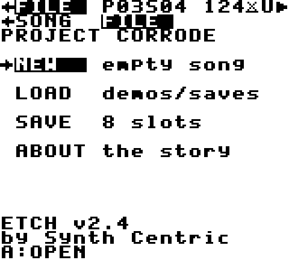 | 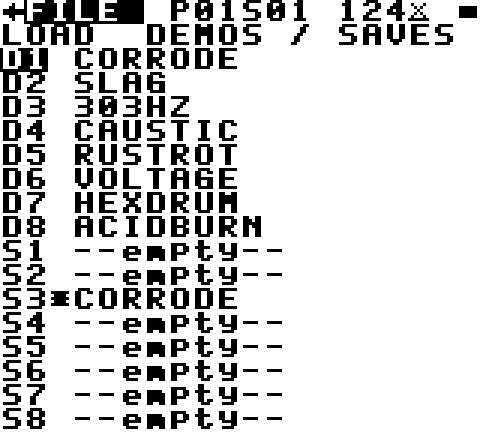 | 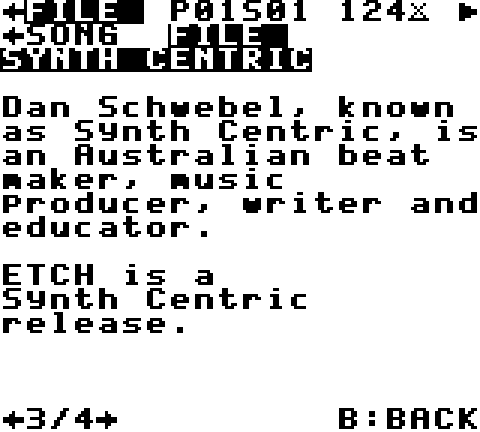 | |

| Title | SYNTH (BAS) | SYNTH (KCK) | TRACK |
|---|---|---|---|
| 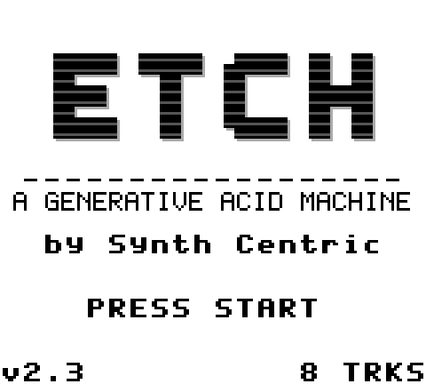 | 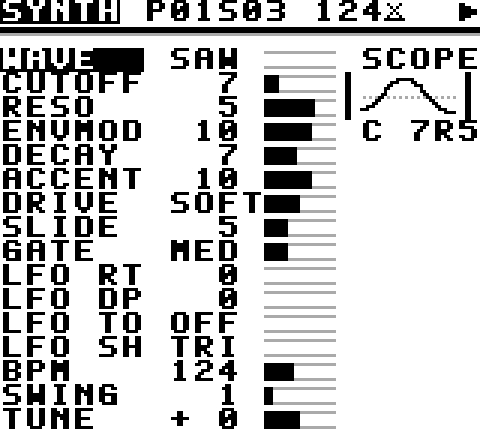 | 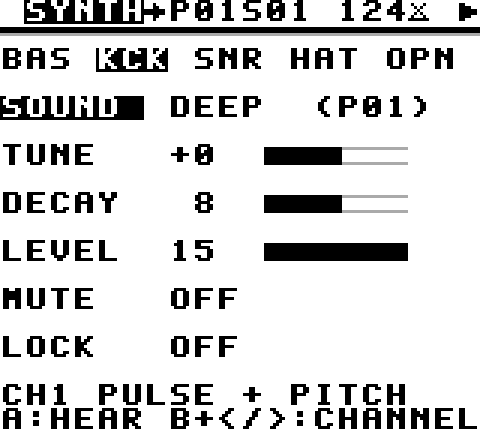 | 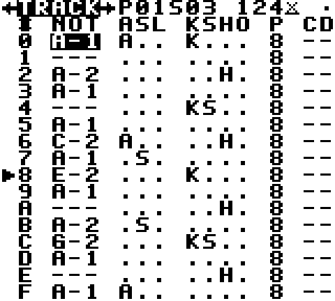 |

| LIVE | GEN | SONG | FILE > SAVE |
|---|---|---|---|
| 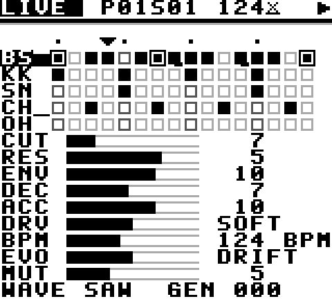 | 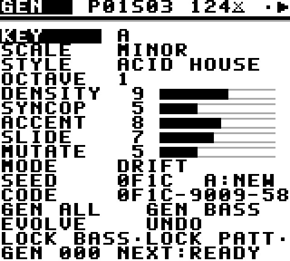 | 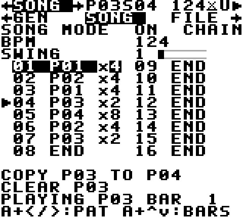 | 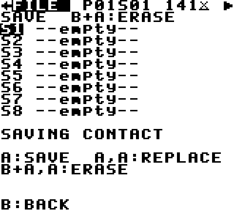 |

## 6. Bugs found and fixed during testing

- **ISR far over budget (~24k cycles):** SDCC's C wave loader cost about 10k cycles. It was rewritten in assembly, and multiplications were replaced with tables. Worst case is now about 14.6k cycles.
- **Swing drift:** the original per-step increments drifted slightly. They were replaced with an exact pair-phase clock; the error is now within one step after 5 minutes.
- **Main loop too slow (23 Hz) and missed taps:** SDCC 16-bit modulo in number printing and per-frame redraws were the cause. Fixed with subtraction-based decimals, cached header fields and change-only redraws, plus VBlank-latched input. Now about 47 Hz.
- **Save took about 1 s:** the checksum was rewritten in assembly and only the affected slot is rescanned.
- **CORROSION musical problems:**
  - DRIFT random-walked away from the groove; fixed with an anchor and bounded divergence.
  - CORRODE filled every step with accents; fixed with density and accent homeostasis.
- **Evolution stalled after chain changes:** the candidate is now retargeted when playback moves to another pattern.
- **Build reproducibility:** a generated source was not listed explicitly in the Makefile, so it would not regenerate after deletion. Fixed.
- **2.5 test fix:** the RESONANCE check compared spectral centroids. Its result swung between 5 % and 10 % depending on how the capture window lined up with the notes, so it occasionally failed. It now compares harmonic profiles against a control capture, which is stable.
- **2.4:** the first REGEN version took about 12 frames per tap. It is now pre-composed in the background.
- **2.4 test isolation:** the synth timbre measurements ran in DRIFT, where the new sound drift moved the cutoff between captures. They now run in STABLE.
- **2.3:** the DRIFT memory used a single anchor, so in song mode it reset on every pattern change and could wander. There are now per-pattern anchors.
- **2.3:** song-mode evolutions were skipped at chain boundaries. Evolution now targets the next bar's pattern.
- **2.3:** evolution randomness was derived from the project seed, so every listener heard the same evolution. It now uses an entropy pool from button timing.
- **2.3 tests caught:** the FILE list title was hidden by the map flash, and an erased slot kept its star. Both fixed.
- **1.1 drum voicing in the ISR** pushed the worst-case tick over the period; it is now precomputed in the main loop.
- **Test-harness bugs:** `wav`/`wavstop` parsing, and NR33/34 being write-only, were fixed in the tests, not the ROM.

## 7. Not verified

- **Real DMG / CGB / GBA hardware**, including real-hardware wave-RAM behaviour and analogue output. Everything above is emulation.
- **Flash cartridge SRAM persistence** on specific products.
- **Subjective sound quality.** No one listened to the output during development. Musical judgement rests on the composition rules, the tests above and objective audio analysis. Please listen to `release/ETCH_Demo.wav` and judge.
- **BGB** was not used (Windows-only; not available in this environment).
